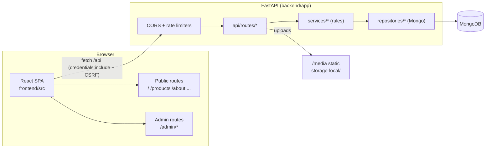

# Admin Panel — Feature & Content Audit

> Read-only audit of the Car Decor Platform admin console, the API it drives, and
> how admin-managed vs. static content flows into the public storefront.
> No code was changed to produce this document.
>
> Repo: `car-decor-platform` · Branch: `master`/`main` · HEAD at audit time: `50ee23e`
> Evidence method: direct file reads of `backend/app/**`, `frontend/src/**`,
> `frontend/index.html`, `frontend/public/**`, plus route/model/service/repo walkthroughs.
> Every claim below carries a `path:line` anchor.

## 1. Executive Summary

The admin console is a **7-section single-page app** mounted under `/admin`, talking to a
FastAPI + MongoDB API under `/api`. It is **functionally complete** for the core commerce
back-office: products, categories, subcategories, testimonials, shop settings (incl. theme),
and account/security.

- Admin SPA sections: **Dashboard, Products, Categories, Subcategories, Testimonials,
  Shop Settings, Account** (`frontend/src/features/admin/layout/AdminShell.tsx:17-23`).
- Public storefront is a React SPA that renders a **mix** of admin-managed content and
  **hardcoded** marketing content.
- Admin-managed content that reaches the storefront: **shop identity/contact/social, theme
  colors, catalog (categories/subcategories/products), testimonials, sitemap**.
- Hardcoded content that admin cannot edit: **hero copy + hero image, value propositions,
  "why choose us" reasons, nav labels, tagline, footer copy/quick links, about-page features,
  page banner headings, CTA copy, and several fallback brand strings**.
- Known inconsistencies (see §14): brand name differs across `index.html` / SEO / Header /
  Footer; Footer + ContactInfo silently drop some social networks; one admin feature folder
  (`catalog/CatalogAdminPage.tsx`) is exported + tested but **not routed**; default theme
  preset id (`automotive-orange`) does not match the default indigo primary (`#363199`).
- Test status at audit time: backend **327 passed**; frontend **397 passed, 1 failed**
  (`frontend/src/features/admin/products/ProductForm.test.tsx:205`, pre-existing image-upload
  assertion failure).

> Product decision: storefront theme is currently **indigo** (`#363199`) because the default
> theme seed/preset uses that primary, while preset **ids** are named for other palettes.

## 2. Architecture Overview

- App factory + mounts: `backend/app/main.py` (Mongo connect + `ensure_indexes` in lifespan
  `:40-43`, `/media` StaticFiles `:98`, router includes `:100-105`).
- Config: `backend/app/core/config.py` (JWT minutes, admin seed email/password, Mongo URI, CORS,
  `storage-local/` path; see §12 env vars).
- Layering rule (per `AGENTS.md`): routers thin → `services/` rules → `repositories/` Mongo.
- Frontend client: `frontend/src/lib/api/client.ts` (`API_BASE = import.meta.env.VITE_API_BASE_URL ?? ""`,
  `request()` sends `credentials:"include"` and adds `X-CSRF-Token` on non-GET; throws
  `ApiRequestError(status, detail)`).

## 3. Frontend Map

Routes (`frontend/src/app/router/index.tsx`, table at `:38-116`):

| Path | Element | Access |
|---|---|---|
| `/` | `HomePage` | public (`:41`) |
| `/products` | `ProductsPage` | public (`:42`) |
| `/products/:slug` | `ProductDetailPage` | public (`:44`) |
| `/categories/:slug` | `CategoryProductsPage` | public (`:43`) |
| `/about` | `AboutPage` | public (`:45`) |
| `/contact` | `ContactPage` | public (`:46`) |
| `/testimonials` | `TestimonialsPage` | public (`:47`) |
| `/admin/login` | `AdminLoginPage` | public (`:69`) |
| `/admin/forgot-password` | `ForgotPasswordPage` | public (`:80`) |
| `/admin/reset-password` | `ResetPasswordPage` | public (`:85`) |
| `/admin` | `DashboardPage` | admin, index `end` (`:100`) |
| `/admin/products` | `ProductsAdminPage` | admin (`:101`) |
| `/admin/products/new` | `ProductFormPage` | admin (`:102`) |
| `/admin/products/:productId/edit` | `ProductFormPage` | admin (`:103`) |
| `/admin/categories` | `CategoriesAdminPage` | admin (`:104`) |
| `/admin/subcategories` | `SubcategoriesAdminPage` | admin (`:106`) |
| `/admin/testimonials` | `TestimonialsAdminPage` | admin (`:108`) |
| `/admin/shop` | `ShopSettingsAdminPage` | admin (`:109`) |
| `/admin/account` | `AccountSettingsPage` | admin (`:110`) |
| `*` | redirect → `/admin` | – |

- Admin shell/nav: `frontend/src/features/admin/layout/AdminShell.tsx:17-23` (`NAV_ITEMS`).
- Feature folders: `frontend/src/features/admin/{dashboard,products,catalog,testimonials,settings,account,auth,layout}/`.
- **Orphaned component**: `frontend/src/features/admin/catalog/CatalogAdminPage.tsx:19` (default
  export) is re-exported (`catalog/index.ts:1`) and tested (`catalog/CatalogAdminPage.test.tsx:8,:49,:52`)
  but the router uses `CategoriesAdminPage`/`SubcategoriesAdminPage` directly — so the combined
  "Catalog" tabbed page is dead UI.
- Shared API client methods: `frontend/src/lib/api/client.ts:100-366` (see §9).
- Shared types: `frontend/src/types/api.ts`.

## 4. Backend Map

`backend/app/`:

- `api/routes/` — `health.py`, `auth.py`, `shop.py`, `catalog.py`, `products.py`,
  `testimonials.py`, `seo.py`.
- `services/` — business rules: auth, catalog, products (`SORT_KEYS`, `MAX_PAGE_SIZE=100`,
  `DEFAULT_PAGE_SIZE=20`), testimonials (`DEFAULT_FEATURED_PAGE_SIZE=9`, visibility = approved ∧
  published ∧ consent), shop settings, storage.
- `repositories/` — all Mongo access, one per collection.
- `models/` — Pydantic + BSON: `admin_user.py`, `category.py`, `subcategory.py`, `product.py`,
  `testimonial.py`, `shop_settings.py`, `base.py`, `enums.py`.
- `db/` — `mongo.py` (client/db accessor), `indexes.py` (index creation).
- `core/` — `config.py` (settings), `errors.py` (domain errors → mapped in routes).
- `storage/` — `base.py`, `images.py` (validation), `local.py`, `s3.py` (optional adapter).
- `deps.py` / `api/dependencies.py` — `get_current_admin`, admin + CSRF dependencies.
- `seed.py` — bootstraps default admin (from env) and optional sample data.

Collections: `admin_users`, `categories`, `subcategories`, `products`, `shop_settings`,
`testimonials` (`backend/app/db/indexes.py:24-69`).

## 5. Admin Navigation Inventory

| # | Nav label | Route | Page component | Primary API |
|---|---|---|---|---|
| 1 | Dashboard | `/admin` | `DashboardPage` | `GET /api/admin/products`, `GET /api/admin/testimonials`, `GET /api/admin/...` (counts) |
| 2 | Products | `/admin/products` | `ProductsAdminPage` | `GET/POST /api/admin/products`, `PATCH stock`, `DELETE` |
| 3 | Categories | `/admin/categories` | `CategoriesAdminPage` | `GET/POST/PUT/DELETE /api/admin/categories` |
| 4 | Subcategories | `/admin/subcategories` | `SubcategoriesAdminPage` | `GET/POST/PUT/DELETE /api/admin/subcategories` |
| 5 | Testimonials | `/admin/testimonials` | `TestimonialsAdminPage` | `GET/PUT/PATCH/DELETE /api/admin/testimonials` |
| 6 | Shop Settings | `/admin/shop` | `ShopSettingsAdminPage` | `GET/PUT /api/admin/shop` |
| 7 | Account | `/admin/account` | `AccountSettingsPage` | `PATCH /api/admin/auth/email`, `POST /api/admin/auth/password` |

## 6. Feature Matrix (admin)

| Feature | UI | Read | Create | Update | Delete/State | Notes |
|---|---|---|---|---|---|---|
| Dashboard | ✅ | ✅ | – | – | – | Live counts via `Promise.all` (`DashboardPage.tsx:66-71`); placeholder `—` on error (`:47`) |
| Products | ✅ | ✅ | ✅ | ✅ | ✅ | Multipart image upload; inline availability/active/stock PATCH; tags |
| Categories | ✅ | ✅ | ✅ | ✅ | ✅ | name/desc/image/active/sort_order |
| Subcategories | ✅ | ✅ | ✅ | ✅ | ✅ | belongs to a category; slug generated |
| Testimonials | ✅ | ✅ | (public submit only) | ✅ | ✅ | status/published/featured toggles; edit + delete |
| Shop Settings | ✅ | ✅ | – | ✅ | – | general/contact/social + theme editor |
| Account | ✅ | (session) | – | email/password | – | security flows |

## 7. Detailed Analysis

### 7.1 Dashboard (`features/admin/dashboard/DashboardPage.tsx`)
- **CONFIRMED.** Fetches aggregate counts (products total / active, categories, testimonials,
  pending) via `Promise.all` (`:66-71`). Renders placeholder `—` while loading or on failure
  (`:47`), page title `:89-91`. No write actions. ADMIN-MANAGED-READ (reflects catalog state).

### 7.2 Products (`features/admin/products/`)
- `ProductsAdminPage.tsx` — list + filters; `SORT_OPTIONS` `:23-30`, `PAGE_SIZE=10` `:34`.
- `ProductForm.tsx` — create/edit; `isValidAbsoluteHttpUrl` `:17-24`; single image field;
  availability select; tags. Tests: `ProductForm.test.tsx`
  (⚠ pre-existing failing assertion at `:205`, image included in POST form data).
- Endpoints: `backend/app/api/routes/products.py` (admin_router `:55`, endpoints `:102-309`);
  stock PATCH enforces ±1 (`services/products.py`); public route `:56`.
- Product fields admin controls: name, description, price (BSON `Decimal128`, submitted as
  string), category, subcategory, availability (`IN_STOCK|OUT_OF_STOCK|ON_ORDER`), is_active,
  vehicle tags, single image (upload or absolute http URL), external URL.

### 8.2 Categories & Subcategories

- `features/admin/catalog/` holds `CategoriesAdminPage.tsx`, `SubcategoriesAdminPage.tsx`,
  helpers (`helpers.ts`: `toAdminError`, `slugify`, `sortCatalogRows`), and the orphaned
  `CatalogAdminPage.tsx`. Hooks `useAdminCategories.ts` / `useAdminSubcategories.ts` normalize
  paged-or-array responses.
- Model bounds (`backend/app/models/category.py`): `MAX_NAME_LENGTH=120` `:8`,
  `MAX_DESCRIPTION_LENGTH=400` `:9`, `MAX_IMAGE_URL_LENGTH=500` `:10`, `MAX_SORT_ORDER=10000`
  `:11`; fields `:17-22`. Unique slug index (`indexes.py`) + active/sort index.

### 7.3 Shop Settings
- `ShopSettingsAdminPage` → `ShopSettingsForm.tsx` (general/contact/social) +
  `ThemeEditor.tsx`.
- Social keys accepted by backend (`models/shop_settings.py:11-13`): **instagram, facebook,
  twitter, youtube, linkedin, telegram, whatsapp, website**; labels in
  `ShopSettingsForm.tsx:22-31`; inputs `:235-245`.
- Theme editor: `COLOR_FIELD_LABELS` (`ThemeEditor.tsx:13-21`), preset `<select>` `:94-113`,
  contrast warnings `:126-135`, scoped live preview `:137-142`.
- Model validation: `_HEX_COLOR_PATTERN ^#[0-9a-fA-F]{6}$` (`shop_settings.py:21`),
  `_PRESET_PATTERN` `:22`, `DEFAULT_THEME_VALUES` `:27-36`.
- Repository: singleton doc `SHOP_SETTINGS_ID = ObjectId("000000000000000000000001")`
  (`repositories/shop_settings.py:12`).

### 7.4 Testimonials (admin side)
- `TestimonialsAdminPage.tsx` — `STATUS_OPTIONS:24-29`, `STATUS_META:31-38`, `PAGE_SIZE=10:22`.
- Admin actions: edit content, `PATCH` status (pending/approved/rejected), `published`,
  `is_featured`, delete.
- Public submission (`POST /api/testimonials`): starts `pending`, honeypot field `website`,
  per-IP rate limit; hidden unless `status=approved AND published ∧ consent`.
- Related client methods: `adminSetTestimonialStatus/Publication/Feature` (`client.ts:335-360`).

### 7.5 Account & Auth

- `AccountSettingsPage` → `ChangeEmailForm.tsx` (handles `409` duplicate email) +
  `ChangePasswordForm.tsx` (uses `PASSWORD_MIN_LENGTH` from `features/admin/auth/passwordPolicy.ts`).
- Login/forgot/reset pages: `pages/admin/auth/{AdminLoginPage,ForgotPasswordPage,ResetPasswordPage}.tsx`;
  reset flow uses `?token=` query; 429 handling.
- Backend `backend/app/api/routes/auth.py` prefix `/admin/auth` (`:28`), timing pad
  `_FORGOT_PASSWORD_TIMING_PAD_SECONDS=0.4` (`:33`).

## 8. Database Models (collections)

| Collection | Model | Key fields | Indexes (`db/indexes.py`) |
|---|---|---|---|
| `admin_users` | `admin_user.py` | email, password_hash, role, is_active | unique email (`:24-69`) |
| `categories` | `category.py` | name, slug, description, image_url, is_active, sort_order | unique slug; active+sort |
| `subcategories` | `subcategory.py` | name, slug, category_id | unique (category, slug) |
| `products` | `product.py` | name, slug, price(Decimal128), category_id, subcategory_id, availability, stock, tags, image, external_url, is_active | slug, category, subcategory, active+availability, active+created, vehicle_tags |
| `shop_settings` | `shop_settings.py` | singleton; name/logo/contact/social/theme | fixed `_id` |
| `testimonials` | `testimonial.py` | name, rating, message, status, is_published, is_featured, consent, is_visible | public visibility; status+created |

- Money is `Decimal128` (serialized as string), datetimes naive UTC (per `AGENTS.md`).
- `shop_settings` regex validators: hex `^#[0-9a-fA-F]{6}$` (`:21`), preset pattern (`:22`),
  social keys (`:11-13`), `DEFAULT_THEME_VALUES` (`:27-36`).

## 9. API Inventory

Public:

| Method | Path | Notes |
|---|---|---|
| GET | `/api/health`, `/api/health/ready` | `health.py:24,:36` |
| GET | `/api/shop` | `shop.py:24` |
| GET | `/api/categories`, `/api/categories/{slug}` | catalog |
| GET | `/api/categories/{slug}/subcategories` | catalog |
| GET | `/api/products` | filters: search, category, subcategory, vehicle, availability, sort, page, page_size |
| GET | `/api/products/{slug}` | catalog |
| GET | `/api/testimonials` | approved ∧ published ∧ consent |
| GET | `/api/testimonials/featured` | + is_featured |
| POST | `/api/testimonials` | submit (pending; honeypot; rate-limited) |
| GET | `/sitemap.xml` | root-level (`seo.py`) |

Admin (require admin session; mutating also require CSRF):

| Method | Path |
|---|---|
| POST | `/api/admin/auth/login` |
| POST | `/api/admin/auth/logout` |
| GET | `/api/admin/auth/me` |
| PATCH | `/api/admin/auth/email` |
| POST | `/api/admin/auth/password` |
| POST | `/api/admin/auth/forgot-password` |
| POST | `/api/admin/auth/reset-password` |
| GET/PUT | `/api/admin/shop` (`shop.py:30,:36`) |
| GET/POST/PUT/DELETE | `/api/admin/categories`, `/api/admin/subcategories` |
| GET/POST/PUT/DELETE | `/api/admin/products` (+ `PATCH stock`) (`products.py:102-309`) |
| GET/PUT/PATCH/DELETE | `/api/admin/testimonials` (`testimonials.py`) |

- Session: HTTP-only cookie + `X-CSRF-Token` header (double-submit). CSRF header is added by the
  SPA on non-GET requests (`client.ts`).
- `GET /api/admin/shop` returns 404 `_NOT_CONFIGURED` until seeded (`shop.py:12-15`).

## 10. Upload / Storage

- Product images: multipart upload → validated (jpeg/png/webp magic-byte sniff + size cap) →
  written via the local adapter into `storage-local/` → served at `/media/...`
  (`main.py:98`; adapter `backend/app/storage/local.py`; validation `storage/images.py`).
- Single image per product; an external absolute URL is also accepted
  (`ProductForm.tsx:17-24` absolute-URL check).
- `s3.py` exists as an optional adapter but local storage is the default.

## 11. Public Page Map

| Public page | Route | Sections / data source |
|---|---|---|
| Home | `/` | Hero (static) + ValueProps (static) + Categories (admin) + Featured Products (admin) + Why-Choose (static) + Featured Testimonials (admin) + Contact CTA (admin-shop) |
| Products | `/products` | catalog list (admin); banner heading static; sort/filter |
| Product detail | `/products/:slug` | admin product |
| Category | `/categories/:slug` | admin catalog |
| About | `/about` | static features + `shop_name` |
| Contact | `/contact` | shop contact/social (admin) + static form copy |
| Testimonials | `/testimonials` | approved testimonials (admin) |

Home composition (`frontend/src/features/home/*`):

- `HeroSection` — **STATIC** (headline "Premium Car Decors" / "for a Better Journey",
  eyebrow "Drive in Style", support text, background `/images/hero-bg.svg`).
- `ValuePropositions` — **STATIC** (4 hardcoded items `:4-26`).
- `WhyChooseSection` — **STATIC** (heading + 3 reasons `:5-21`).
- `CategorySection` — **DYNAMIC** (`api.getCategories`, filters `is_active` `:20`).
- `FeaturedProducts` — **DYNAMIC** (`page_size 8`).
- `FeaturedTestimonials` — **DYNAMIC** (`MAX_FEATURED = 6` `:9`).
- `ContactCTA` — **DYNAMIC**, rendered only when shop settings are present (`:15-19`).

Other public features:

- `features/info/AboutSection.tsx` — static features + `shop?.shop_name ?? "SLG Car Decors"` (`:29`).
- `features/info/ContactInfo.tsx` — from shop settings; social whitelist instagram/facebook/
  youtube/twitter/linkedin (`:5-11`).
- `features/products/*`, `features/testimonials/*` — dynamic.

## 12. SEO Overview

- `frontend/src/lib/seo.ts` — `SITE_URL = "https://car-decors.duckdns.org"` (`:12`),
  `FALLBACK_BRAND = "SLG Car Decors"` (`:15`), `DEFAULT_OG_IMAGE = "/images/og-default.png"` (`:18`);
  applied by `components/seo/SeoHead.tsx` via `applySeo`.
- `frontend/public/robots.txt` — `Disallow: /admin/`, `Disallow: /api/`,
  `Sitemap: https://car-decors.duckdns.org/sitemap.xml`.
- `frontend/index.html` — `<title>SLG Real Value Car Decors | Car Accessories & Car Decor</title>`,
  canonical `https://car-decors.duckdns.org`, `theme-color #0a0a0f`.
- Backend sitemap: `backend/app/api/routes/seo.py` — `_STATIC_ROUTES` (`:25-30`),
  `_MAX_URLS = 50_000` (`:33`), base URL default `https://car-decors.duckdns.org` (`:39`);
  generated from active catalog, served at `/sitemap.xml`.

## 13. Data-Source Classification

### ADMIN-MANAGED (storefront reflects admin edits)
- Shop identity/contact: `shop_name`, `logo_url`, phone, WhatsApp, email, address, business hours.
- Social links: instagram, facebook, twitter, youtube, linkedin, telegram, whatsapp, website.
- Theme: preset id, primary/secondary/accent/background/surface/text colors.
- Catalog: categories, subcategories, products (name, description, price, availability, stock, tags,
  image, external URL, active).
- Testimonials: name, rating, message, status, published, featured.
- Sitemap URLs (derived from active catalog).

### BACKEND-DERIVED
- Storefront counts (Dashboard), product availability label, category→product relations.

### STATIC-HARDCODED (admin cannot edit)
- Hero eyebrow "Drive in Style", headline "Premium Car Decors" / "for a Better Journey",
  hero support text, hero background `/images/hero-bg.svg`.
- `ValuePropositions` 4 items; `WhyChooseSection` heading + 3 reasons.
- Header `navLinks` (5) + `BRAND_TAGLINE = "Real Value Car Decors"` + default brand.
- Footer quick links + description ("Premium car accessories…") + fixed social icon set.
- About-page features (4) + fallback brand.
- Page banner headings (Products "All Products"/"Showroom", About "Our Story",
  Testimonials "Trusted Feedback", Contact "We're Here to Help").
- CTA copy; `FeaturedProducts` / `CategorySection` / `FeaturedTestimonials` section headings.
- `ThridhaSignature` credit links.
- `index.html` title/meta; `robots.txt` sitemap URL; SEO fallbacks (`FALLBACK_BRAND`,
  `SITE_URL`, `og-default` image); hardcoded city string "Hanamkonda, Telangana" in descriptions.

### CONFIG
- `VITE_API_BASE_URL` (frontend), `VITE_*` proxies; backend `.env` (Mongo URI, JWT secret,
  admin seed email/password, CORS origins, storage path). See `PRODUCTION_CONFIGURATION.md`.

## 14. Inconsistencies, Gaps & Risks

1. **Brand name drift** — `index.html` ("SLG Real Value Car Decors"), SEO
   `FALLBACK_BRAND` ("SLG Car Decors"), Header tagline ("Real Value Car Decors") + fallback
   ("Car Decor"), Footer fallback ("Car Decor"), About fallback ("SLG Car Decors").
2. **Footer/ContactInfo drop social networks** — admin supports 8 social keys, but Footer
   (`Footer.tsx:53-55`) and `ContactInfo.tsx:5-11` only render 5; **telegram/website** are
   silently dropped (WhatsApp is rendered as a separate hardcoded `wa.me` button, `Footer.tsx:130`).
3. **Orphaned admin page** — `catalog/CatalogAdminPage.tsx` is exported + tested but unreachable
   via the router.
4. **Theme default naming mismatch** — default preset id `automotive-orange`
   (`shop_settings.py` `DEFAULT_THEME_VALUES`) with primary `#363199` (indigo) and
   `AUTO_INDIGO_VARS` (`theme/resolve.ts:31`); default preset is indigo, not orange.
5. **Hardcoded hero/marketing** — a large share of homepage copy/images cannot be edited from
   the admin console (list in §13).
6. **Frontend test failure** — `ProductForm.test.tsx:205` (image-upload form assertion) fails;
   pre-existing, not caused by this audit.

## 15. Verification & Evidence Levels

- **CONFIRMED**: read directly from source at the cited `path:line`.
  (Router table, `NAV_ITEMS`, API client methods, shop_settings social keys + theme defaults,
  home-section static/dynamic split, index.html/robots/seo constants, indexes.)
- **PARTIALLY VERIFIED**: multi-hop assertions inferred from two or more files but not runtime-
  exercised here (e.g. exact Dashboard count endpoint set; the full list of PATCH sub-routes).
- **UNVERIFIED**: none considered blocking; runtime behavior of the SPA against a live API was
  not exercised (no server was started for this audit).

## 16. Test Status (at audit time)

| Suite | Command | Result |
|---|---|---|
| Backend | `backend\.venv\Scripts\python.exe -m pytest backend\tests -q` | **327 passed** |
| Frontend | `npm run test` (vitest run) | **397 passed, 1 failed** — `frontend/src/features/admin/products/ProductForm.test.tsx:205` |

No source files were modified by this audit.

## 17. Redesign Notes (input for the storefront redesign)

- Decide which §13 "STATIC-HARDCODED" blocks become **admin-managed** (hero copy/image, value
  props, why-choose reasons, page banners, footer copy). This drives new `shop_settings` fields
  (or a new `site_content` collection) + model validators + form fields.
- Normalize the **brand name** into a single admin-managed `shop_name` + a documented fallback,
  and update `index.html`, SEO fallbacks, Header/Footer, About.
- Unify **social link rendering** to honor all 8 keys (add telegram/website to Footer & ContactInfo,
  or filter intentionally and document it).
- Resolve the **orphaned `CatalogAdminPage`** (either route it or remove it).
- Align the **default theme** (preset id vs. primary color) before redesign.

## 18. Appendix — Key File:Line Anchors

- `frontend/src/app/router/index.tsx:38-116`, admin routes `:100-109`
- `frontend/src/features/admin/layout/AdminShell.tsx:17-23`
- `frontend/src/features/admin/catalog/CatalogAdminPage.tsx:19`, `catalog/index.ts:1`, test `:8,:49,:52`
- `frontend/src/lib/api/client.ts:100-366` (`getShopSettings` `:100-102`; `adminAdjustProductStock` `:303`; `adminSetTestimonial*` `:335-360`)
- `frontend/src/lib/theme/presets.ts:4-13,16-24,49-104`; `theme/resolve.ts:3-27,31`; `theme/apply.ts:36-40`
- `frontend/src/lib/seo.ts:12,15,18`; `frontend/src/components/seo/SeoHead.tsx`
- `frontend/src/components/layout/Header.tsx:7-13,15,69`; `Footer.tsx:53-55,130`
- `frontend/src/features/home/{HeroSection,ValuePropositions(4-26),WhyChooseSection(5-21),CategorySection(20),FeaturedProducts,FeaturedTestimonials(9),ContactCTA(15-19)}`
- `frontend/src/features/admin/{dashboard/DashboardPage.tsx(47,66-71,89-91),products/ProductsAdminPage.tsx(23-30,34),products/ProductForm.tsx(17-24),testimonials/TestimonialsAdminPage.tsx(22,24-29)}`
- `frontend/index.html`; `frontend/public/robots.txt`
- `backend/app/main.py:40-43,98,100-105`
- `backend/app/api/routes/{seo.py(25-30,33,39),shop.py(12-15,24,30,36),auth.py(28,33),products.py(55,56,102-309),testimonials.py(39,40),health.py(24,36)}`
- `backend/app/models/{shop_settings.py(11-13,21,22,27-36),category.py(8-11,17-22)}`
- `backend/app/repositories/shop_settings.py:12`
- `backend/app/db/indexes.py:24-69`
